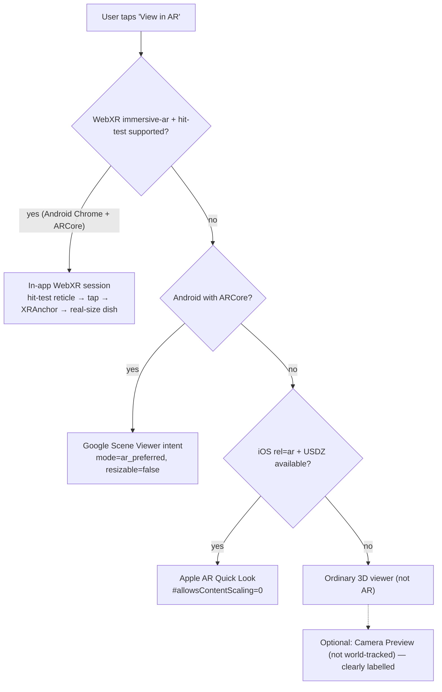

# PHASE 3.2 — AR ARCHITECTURE AUDIT

**Project:** The Golden Oak · **Author:** Lead Orchestrator (with SA1 Tracking audit input) · **Baseline:** git tag `pre-phase3.2-checkpoint` (commit `04b9ec4`)

Evidence labels: `physically-measured` · `browser-or-device-emulated` · `automated-test` · `estimated` · `not-tested`.
All findings in this document are **code-inspection findings** (static audit of the repository) unless stated otherwise.

---

## 1. Platform reality of this repository

| Fact | Evidence |
|---|---|
| The product is a **Next.js 16 web application** (React 19, three 0.185, @react-three/fiber 9). | `package.json` |
| There is **no native Android project, no native iOS project, no Capacitor/React Native shell.** | `android/`, `ios/`, `capacitor.config.*` do not exist |
| Therefore "ARCore" and "ARKit" can only be reached through the browser/OS: WebXR (`immersive-ar`, Chrome on ARCore devices), Google **Scene Viewer** intent (ARCore), and Apple **AR Quick Look** (`<a rel="ar">` + USDZ, ARKit). | Platform specs |
| iOS/iPadOS Safari **does not implement WebXR `immersive-ar`**. In-page world tracking on iOS is impossible from a web page; Quick Look is the only genuine ARKit path. A native ARKit integration would require a separate native iOS app (out of scope for this repo; requires macOS + Xcode). | WebKit feature status |

## 2. What was broken, and why (user-reported → root cause)

| # | User-reported problem | Root cause (file : line, baseline) |
|---|---|---|
| 1 | Dish follows the camera / behaves like a photo overlay | **No XR session ever started.** `ar-capabilities.ts` only calls `navigator.xr.isSessionSupported('immersive-ar')`; no code calls `requestSession`. `/ar/[dishId]` renders `CameraFeed.tsx` (`getUserMedia` `<video>`, L51-128) behind an R3F `<Canvas>` whose virtual camera is fixed at `[0, 2, 3]` (`ARViewer.tsx` ~L863-920). The dish lives in **screen space**; when the phone moves, the video moves but the virtual camera does not. |
| 2 | Tapping does not place the dish on a real table | `ARViewer.tsx` L367-376 `handleTapToPlace` only sets React state `placed = true`. No hit-test, no plane, no anchor. |
| 3 | Dish floats in the air | `ARScene.tsx` L104-137 `ARReticle` is a static mesh at `[0, -0.01, 0]` in a virtual scene. There is no real surface, so "contact" is impossible; the contact disc is drawn under a virtual origin, not a table. |
| 4 | No stable world position | Consequence of #1/#2: nothing is tracked in world space. |
| 5 | Inconsistent dimensions across devices | `ARScene.tsx` L188-209 `normalizedARTransform` rescales **every** dish so its max dimension = **1.4 units** (`targetExtent = 1.4`), then the apparent size depends on the fixed virtual camera FOV and the screen aspect ratio → different phones show different sizes, and no dish has its real size. |
| 6 | Poor AR visual quality | Untextured placeholder (`gourmet-wok-bowl`) for 8 dishes, duplicated models, 1.87M-triangle meshes, JPEG normal maps, no KTX2 actually used in assets, no light estimation, fake dark contact disc (see Phase 2 audit `benchmarks/phase2-22dish-asset-audit.json`). |
| 7 | Insufficient device optimisation in AR | AR path reused the R3F demand-loop viewer stack; no XR-specific profile (framebuffer scale, foveation, shadow technique), no XR frame-time monitoring. |
| — | Fake tracking signal | `ARViewer.tsx` L303-353 + `ar-capabilities.ts` L337-353: `devicemotion` accelerometer deltas (`evaluateMotionStability`) were shown to the user as "Table surface locked" — a heuristic presented as tracking. |
| — | Routing conflation | Every "View in AR" link (`src/app/ar/page.tsx` L220-250, `DishInfoBar.tsx` L250-261, `MenuDishCard.tsx` L214-232, …) went to `/ar/[dishId]`, which defaulted to the non-tracked camera feed. |

## 3. Target architecture (Phase 3.2)

Shared contract: `src/lib/xr/spatial-contract.ts` — 1 unit = 1 m, +Y up, origin = footprint centre at ground contact, ±5 % scale tolerance, `ARExperienceRoute`, `XRTrackingState`, `PlacementRecord`, `DishPhysicalSpec`.

| Module | Owner | Responsibility |
|---|---|---|
| `src/lib/xr/webxr-session.ts` | SA1 | Feature detection, session request (required `hit-test`; optional `anchors`, `dom-overlay`, `light-estimation`, `local-floor`, `depth-sensing`), tracking state machine |
| `src/lib/xr/webxr-ar-engine.ts` | SA1 | Vanilla three `WebGLRenderer` + `renderer.xr`, hit-test source, anchors, tracking-limited handling, light estimation, disposal |
| `src/components/ar/WebXRARExperience.tsx`, `ARTrackingStatus.tsx` | SA1 | dom-overlay UI: scanning / surface detected / placed / tracking limited, Reposition, Reset size |
| `src/lib/xr/placement-math.ts`, `placement-reticle.ts`, `src/data/dish-dimensions.ts` | SA2 | Ground contact, real-size scale, reticle, dish physical specs |
| `src/lib/xr/ar-quality-profile.ts` | SA4 | XR quality profiles + frame-time monitor (tracking first) |
| `public/models/optimized/**`, `src/data/model-config.ts` | SA3 | Dish-specific optimised assets & mapping corrections |
| `tests/phase3-2-*.test.mjs` | SA5 | Automated verification + device test protocols |

## 4. Platform capability matrix (what each path can genuinely do)

| Capability | WebXR in-app (Android Chrome/ARCore) | Scene Viewer (Android) | AR Quick Look (iOS/iPadOS) | 3D viewer | Camera preview |
|---|---|---|---|---|---|
| 6DoF world tracking | Yes | Yes | Yes | No | **No** |
| Horizontal plane detection | Yes (hit-test against ARCore planes) | Yes | Yes | No | No |
| Tap-to-place on table | Yes (our UI) | Yes (Google UI) | Yes (Apple UI, auto-place) | No | No |
| Persistent anchor | `XRAnchor` if `anchors` granted, else fixed reference-space pose | Yes (internal) | Yes (internal) | — | — |
| Tracking recovery | ARCore relocalisation; we keep last anchor | Yes | Yes | — | — |
| Light estimation | `light-estimation` (optional) | Yes | Yes (ARKit env. texturing) | Studio HDR | Static |
| Real-size lock | Our metadata-driven scale + Reset size | `resizable=false` | `#allowsContentScaling=0` | n/a | n/a |
| Controls owned by | The Golden Oak | Google | Apple | The Golden Oak | The Golden Oak |
| Asset format | GLB | GLB | USDZ | GLB | GLB |

## 5. Verification status of this audit

| Item | Label |
|---|---|
| Root causes above | `automated-test` (static code inspection, reproducible from baseline tag) |
| Behaviour on physical Android / iOS devices | `not-tested` (no physical devices available in this environment) |
