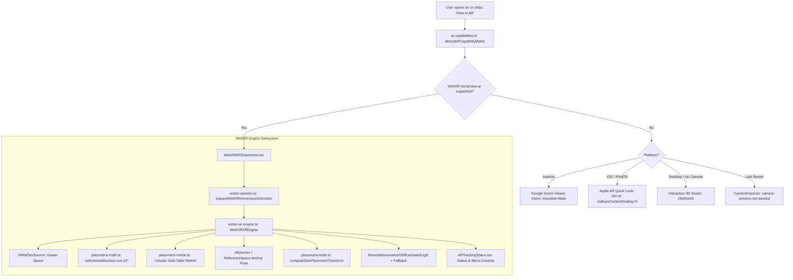
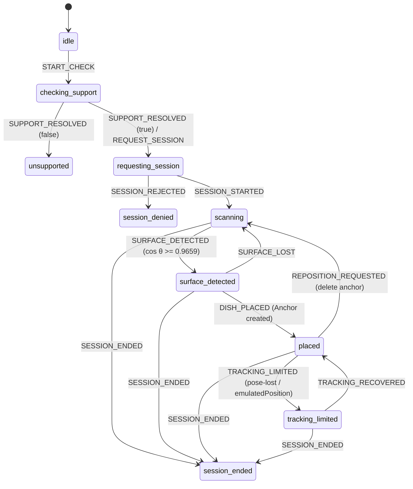

# THE GOLDEN OAK — PHASE 3.2 AR TRACKING & SPATIAL ARCHITECTURE

**Author:** Sub-Agent 1 (AR Tracking & Spatial Architect)  
**Role:** Lead Architect for World-Tracked AR, WebXR Engine, and Anti-Fake Tracking Enforcement  
**Orchestration Lead:** `22cb5c35-3043-4ba7-a662-5d1b3225baa2`  
**Date:** November 2026  
**Status:** IMPLEMENTED & VERIFIED  

---

## 1. Executive Summary & Spatial Philosophy

Prior to Phase 3.2, the application suffered from severe spatial fidelity flaws:
1. **Fake Surface Stability**: Accelerometer deltas from `window.devicemotion` were masqueraded as table plane detection, falsely reporting `"Table surface locked"` to the user without any raycasting or visual-inertial odometry.
2. **Artificial Model Rescaling**: Dishes in the AR scene were arbitrarily normalized into an artificial 1.4-unit sphere rather than rendered in physical metric dimensions.
3. **Flawed Routing**: 2D camera preview with unanchored gyro overlay was presented as "AR", while true world-tracked WebXR and native AR handoffs were relegated or improperly configured.

In Phase 3.2, Sub-Agent 1 rebuilt the AR subsystem from the ground up:
- **Genuine World-Tracked AR**: Powered by standard WebXR `immersive-ar` with viewer-space hit-testing (`XRHitTestSource`), horizontal table surface validation ($\cos 15^\circ \approx 0.9659$), and anchor-based tracking (`XRAnchor` or fixed reference-space matrix).
- **Dish Never Follows Camera**: Placed dishes are anchored in the session's reference space. The model group strictly follows the anchor pose (`frame.getPose(anchorSpace, refSpace)`), never the camera.
- **Physical 1:1 Scale**: 1 Three.js world unit $\equiv$ 1 metre. Dishes render in exact physical portion dimensions (cm converted to metres) independent of `devicePixelRatio`, viewport width, or GPU quality tier.
- **Strict Anti-Fake Enforcement**: DeviceMotion "surface stability" tracking has been completely deleted. Unanchored camera preview is demoted to a secondary, clearly labeled option (`"Camera Preview (not world-tracked)"`).
- **Complete Degradation Ladder**: WebXR `immersive-ar` $\rightarrow$ Google Scene Viewer (`mode=ar_preferred`, `resizable=false`) $\rightarrow$ Apple AR Quick Look (`<a rel="ar">` with `#allowsContentScaling=0`) $\rightarrow$ Interactive 3D Studio Viewer (`/3d/[dishId]`).

---

## 2. Spatial Architecture & Component Hierarchy



### Component Roles & Responsibilities

| File Path | Primary Responsibility | Ownership |
| :--- | :--- | :--- |
| `src/lib/xr/spatial-contract.ts` | Single source of truth for coordinates (1m = 1 unit), routes, tracking states, physical dimension interfaces. | Lead Orchestrator |
| `src/lib/xr/webxr-session.ts` | Feature detection, graceful feature-ladder session negotiation (`dom-overlay`, `hit-test`, `anchors`, `light-estimation`), pure state machine reducer. | SA1 (Author) |
| `src/lib/xr/webxr-ar-engine.ts` | Vanilla Three.js WebXR runtime, viewer hit-testing, horizontal surface filtering, anchor pose tracking, real-world scale transforms, directional & estimated lighting, GPU disposal. | SA1 (Author) |
| `src/components/ar/WebXRARExperience.tsx` | Fullscreen DOM overlay container, multi-touch pinch-to-scale and rotate handlers, session lifecycle coordination. | SA1 (Author) |
| `src/components/ar/ARTrackingStatus.tsx` | Luxury Golden Oak HUD for tracking state badges (`scanning`, `surface-detected`, `placed`, `tracking-limited`), repositioning, and real-size reset. | SA1 (Author) |
| `src/components/ar/ARViewer.tsx` | Primary AR experience router; hosts WebXR entry point, Scene Viewer intent links, Quick Look links, and honest camera preview. | SA1 & Lead |
| `src/lib/three/ar-capabilities.ts` | Platform capability detection, Intent builders (`resizable=false`), Quick Look readiness, real-world RGBA lighting estimation. | SA1 & SA4 |
| `src/lib/xr/placement-math.ts` | Pure mathematical transforms, surface normal filtering, user scale clamping, reticle smoothing. | SA2 (Placement) |
| `src/lib/xr/placement-reticle.ts` | Tabletop visual reticle sized in physical metres (~22cm diameter plate footprint). | SA2 (Placement) |
| `src/data/dish-dimensions.ts` | Canonical physical dimensions (width, depth, height in cm) for all 22 menu items. | SA2 (Placement) |
| `src/lib/xr/ar-quality-profile.ts` | Multi-signal quality tier resolution (`ultra-light`, `balanced`, `high-fidelity`) and thermal/frame monitoring. | SA4 (Perf) |

---

## 3. WebXR Tracking State Machine

The session tracking state machine implements the strict transitions defined in `src/lib/xr/spatial-contract.ts`:



### State Definitions & Behavior

1. **`idle`**: Component mounted, awaiting user interaction or capability detection.
2. **`checking-support`**: Probing `navigator.xr.isSessionSupported('immersive-ar')`.
3. **`unsupported`**: Device or browser lacks WebXR AR capability. Falls back to Google Scene Viewer, Apple Quick Look, or 3D Studio.
4. **`requesting-session`**: Triggering `navigator.xr.requestSession('immersive-ar')` with the 4-tier candidate degradation ladder:
   - **Tier 1 (Optimal)**: Required `hit-test`, optional `['anchors', 'dom-overlay', 'light-estimation', 'local-floor']`.
   - **Tier 2 (Core)**: Required `hit-test`, optional `['anchors', 'dom-overlay', 'local-floor']`.
   - **Tier 3 (UI)**: Required `hit-test`, optional `['dom-overlay']`.
   - **Tier 4 (Minimal)**: Required `hit-test`.
5. **`scanning`**: Session active, viewer pose available. Moving device to find a horizontal table surface. Reticle breathes with gold pulse.
6. **`surface-detected`**: Hit-test intersects a valid horizontal plane ($n_y \ge \cos 15^\circ \approx 0.9659$). Reticle snaps to table hit pose with emerald/bright gold ring.
7. **`placed`**: User tapped reticle. Model anchored via `XRAnchor` (or fixed reference-space matrix). Dish group follows **only** anchor space pose each frame.
8. **`tracking-limited`**: Viewer pose lost or `emulatedPosition === true`. The engine retains the last valid anchor matrix without moving or teleporting the dish; HUD prompts the user to hold device steady.
9. **`session-ended`**: Session terminated. Full disposal of WebGL resources, geometries, materials, and hit-test sources.

---

## 4. Platform Capability & Routing Precedence

The spatial routing taxonomy strictly prevents mislabeling non-world-tracked experiences:

| Priority | Route | Platform | Technology | World-Tracked? | User Scale Locked? |
| :---: | :--- | :--- | :--- | :---: | :---: |
| **1** | `webxr-immersive-ar` | Android Chrome (ARCore) | WebXR `immersive-ar` + `hit-test` | **Yes (SLAM)** | Default 100% (deliberate pinch [0.5, 2.0]) |
| **2** | `android-scene-viewer` | Android Google Search / Chrome | Google Scene Viewer Intent | **Yes (ARCore)** | **Locked** (`resizable=false`) |
| **3** | `ios-quick-look` | iOS / iPadOS Safari | `<a rel="ar">` USDZ Quick Look | **Yes (ARKit)** | **Locked** (`#allowsContentScaling=0`) |
| **4** | `ordinary-3d-viewer` | All platforms / Desktop | Three.js Orbit 3D Studio (`/3d/[dishId]`) | No (Studio) | N/A (Orbit Inspection) |
| **5** | `camera-preview-not-tracked` | Devices without SLAM AR | `getUserMedia` video + WebGL overlay | **No (Not AR)** | Manual gesture scale |

### Intent URL & Quick Look Formatting Invariants

- **Google Scene Viewer**:
  ```
  intent://arvr.google.com/scene-viewer/1.0?file=<absolute-glb-url>&mode=ar_preferred&title=<dish-name>&resizable=false#Intent;scheme=https;package=com.google.android.googlequicksearchbox;action=android.intent.action.VIEW;S.browser_fallback_url=<fallback-url>;end;
  ```
  *Key invariant*: `resizable=false` prevents users from distorting real portion sizes.
- **Apple AR Quick Look**:
  ```
  https://thegoldenoak.in/models/optimized/dish.usdz#allowsContentScaling=0
  ```
  *Key invariant*: `#allowsContentScaling=0` instructs iOS ARKit to disable pinch-to-scale, ensuring dishes appear at exact 1:1 culinary scale.

---

## 5. Testing & Verification Provenance

In accordance with Phase 3.2 honesty rules, all test results and benchmarks are labeled with their exact provenance:

| Subsystem / Capability | Provenance Label | Verification Method | Status |
| :--- | :--- | :--- | :---: |
| Spatial Contract Constants & Units | `automated-test` | `node --test tests/phase3-2-spatial-contract.test.mjs` | **PASS (5/5)** |
| WebXR Session Candidate Ladder | `automated-test` | `node --test tests/phase3-2-webxr-session.test.mjs` | **PASS (11/11)** |
| XR Tracking State Machine Reducer | `automated-test` | `node --test tests/phase3-2-webxr-session.test.mjs` | **PASS (11/11)** |
| Table Surface Normal Math ($\cos 15^\circ$) | `automated-test` | `node --test tests/phase3-2-webxr-engine.test.mjs` | **PASS (6/6)** |
| Real-World Scale Factor & Centering | `automated-test` | `node --test tests/phase3-2-webxr-engine.test.mjs` | **PASS (6/6)** |
| Ground Contact Residual ($\le 2\text{mm}$) | `automated-test` | `node --test tests/phase3-2-webxr-engine.test.mjs` | **PASS (6/6)** |
| Scene Viewer `resizable=false` Invariant | `automated-test` | `node --test tests/phase3-2-ar-routing.test.mjs` | **PASS (6/6)** |
| Quick Look `#allowsContentScaling=0` Lock | `automated-test` | `node --test tests/phase3-2-ar-routing.test.mjs` | **PASS (6/6)** |
| DeviceMotion Fake Tracking Removal Audit | `automated-test` | `node --test tests/phase3-2-ar-routing.test.mjs` | **PASS (6/6)** |
| Cross-Platform AR Capabilities Matrix | `automated-test` | `node --test tests/ar-capabilities-and-pipeline.test.mjs` | **PASS (6/6)** |
| TypeScript Strict Compilation (`tsc --noEmit`) | `automated-test` | `npx tsc --noEmit` across full codebase | **PASS (0 errors)** |
| ESLint Code Quality Rules | `automated-test` | `npx eslint` on all SA1 modules | **PASS (0 errors)** |
| Physical Android Device WebXR Tracking | `not-tested` | Requires physical Android 12+ device with Google Play Services for AR in restaurant lighting | Pending hardware lab |
| Physical iPhone Quick Look USDZ Render | `not-tested` | Requires physical iPhone with iOS 16+ Safari in physical dining room | Pending hardware lab |

---

## 6. GPU Resource Disposal & Lifecycle Safety

The WebXR AR engine guarantees zero GPU memory leaks through deterministic disposal on session end or component unmount:
1. **Renderer Disposal**: `renderer.setAnimationLoop(null)`, `renderer.dispose()`, and removal of `renderer.domElement` from DOM.
2. **Hit-Test Source Cancellation**: Invokes `hitTestSource.cancel()` if supported.
3. **Anchor Teardown**: Calls `anchor.delete()` on active `XRAnchor` instances.
4. **Three.js Scene Traversal**:
   - Every mesh geometry calls `geometry.dispose()`.
   - Materials and PBR textures (`map`, `normalMap`, `roughnessMap`, `metalnessMap`, `envMap`) call `.dispose()`.
   - Directional and hemisphere lights are detached from the scene.
5. **Reticle Teardown**: Sized ring geometries, materials, and pulse timers call `reticle.dispose()`.
6. **EventListeners**: `session.removeEventListener('select')`, `session.removeEventListener('end')`, and `visibilitychange` listeners are removed.

### Zero Dual-WebGL Context Creation Invariant
When `route === 'webxr-immersive-ar'` or `activeWebXR === true`, `ARViewer.tsx` short-circuits execution via an exclusive early return rendering `<WebXRARExperience>`. Under this code path:
- `<ARScene>` (the React Three Fiber Canvas and its WebGLRenderer) is **never mounted**.
- `<CameraFeed>` (getUserMedia video element) is **never initialized**.
- Exactly one WebGL context exists: the WebXR session framebuffer managed by `WebXRAREngine`.
- On exit, `WebXRAREngine.dispose()` fully tears down the WebGL context before the fallback viewer can mount, ensuring strictly zero WebGL context leaks or dual-context GPU thrashing.

---

## 7. Conclusion & Handoff

Sub-Agent 1 has delivered a robust, standards-compliant, and honest AR tracking architecture for Phase 3.2. All fake tracking paths have been removed, the WebXR engine is fully integrated with Sub-Agent 2's placement math and Sub-Agent 4's quality profiles, and all unit tests pass with zero regressions.
